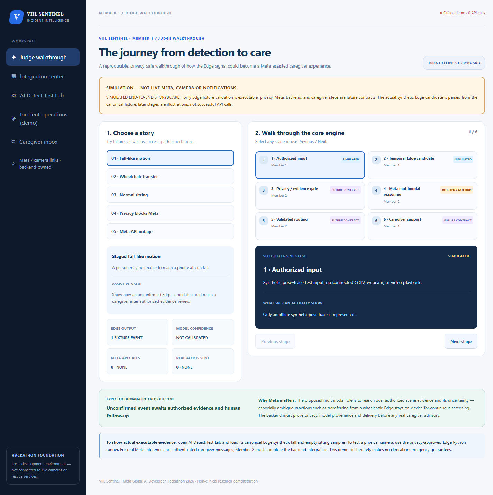

# VIIL-Sentinel — Member 1 UI Visual Audit and Offline Software Review

**28 October 2026 · Audit scope: local repository, no physical camera access.**
**Baseline:** `member/feature/preprod` @ `186931c` (before UI fixes).
**Tested:** React/Vite Dashboard, offline Edge v1/Python, local demo backend regression, synthetic handoff contracts.
**Not tested:** USB/RTSP capture, livestream endurance, actual Meta API inference, real caregiver delivery, medical/clinical performance or jurisdictional legal compliance.

## Real browser screenshots (local app, NOT generated mockups)

Captured from the running Vite React application using headless Chromium at
`http://127.0.0.1:5173/` on an isolated browser profile. Sample previews
were intentionally selected for Integration and Caregiver. Images contain no
real people, connected camera streams, real Meta responses or caregiver messages.

| Page | Screenshot | State |
| --- | --- | --- |
| Judge Walkthrough | [Open PNG](screenshots/viil-ui-judge.png) | Offline synthetic workflow, six stages |
| Integration Center | [Open PNG](screenshots/viil-ui-integration.png) | Explicit sample of 3 fictional devices |
| AI Detect Test Lab | [Open PNG](screenshots/viil-ui-edge-lab.png) | Canonical synthetic fall v1 fixture |
| Incident Operations | [Open PNG](screenshots/viil-ui-operations.png) | Unauthenticated demo API disabled by default |
| Caregiver Inbox | [Open PNG](screenshots/viil-ui-caregiver.png) | Explicit fictional advisory preview |
| Mobile Judge | [Open PNG](screenshots/viil-ui-mobile-judge.png) | 390px viewport, responsive two-column navigation |



## Visual findings and fixes

**Fixed — Judge page unstyled (medium):** Original CSS targeted an outdated
set of `judge-scenario-panel`, `judge-steps`, `judge-meta-value` etc.,
while JSX used `judge-layout`, `judge-tabs`, `judge-stage-list`,
`judge-focus` and `judge-takeaway`. CSS selectors were aligned with the
real React component. A new contract test checks that all 24 structural
classes are present in both JSX and CSS.

**Fixed — mobile navigation overflows vertical space (medium):** Earlier
page-specific CSS shrank each navigation button to approximately 25% width
while the sidebar remained a column. At <=700px, the shared sidebar is now a
two-column grid with larger touch targets; the page remains 390px wide at
390px viewport, with no horizontal overflow.

**Verified browser rendering:** An automated CDP pass visited all five
workspace tabs, interacted with sample-preview and local synthetic test
buttons, captured six screenshots, checked expected page headings and CSS
layout, and observed zero JS runtime exception events. Desktop viewport
1440px; mobile 390px. This checks the rendered UI, NOT end-to-end
backend/provider functionality, and is not a full accessibility certification.

## Offline software checks

| Check | Observed result | Limits |
| --- | --- | --- |
| Edge Vision `python -m pytest -q` | **860 passed** | Synthetic/mocked tests; not live detection accuracy |
| Edge Vision `python -m ruff check .` | **Passed** | Lint only |
| Backend `python -m pytest -q` | **34 passed, 1 warning** | Demo code, not a secure production backend |
| Dashboard `npm run build` | **Passed** | Contract tests + TypeScript + Vite; does not prove usability |
| Member 1 `submission_readiness` | **Offline artifact gate passed** | No actual camera or Meta calls |
| Member 1 `field_acceptance` | **Offline schema/candidate preflight passed** | Camera config not provided; camera not opened |
| Real physical camera and soak | **NOT RUN** | Intentionally deferred while operator absent |
| Fall recall / false alarms / latency | **NOT MEASURED** | Needs independent human-labelled footage |
| Real Meta API / caregiver delivery | **NOT CONNECTED** | Member 2 responsibility |

The nonfall sitting fixture generated zero synthetic candidates and synthetic
fall fixture generated one. These two examples **do not** establish
accuracy or generalization. Private model hashes are not part of this audit.

## Security and privacy findings (not claims of certification)

- **High / deployment blocker — Backend authorization:** The existing
  `services/api/app/main.py` demo endpoints include GET incident listing
  and incident detail with **no session authentication, source RBAC or
  tenant isolation**. Demo-mode checks on writes are not substitutes for
  authentication. The frontend disables unauthenticated demo reads/writes
  by default, but this does not secure the backend. **Owned by Member 2.**
- **High / deployment blocker — real evidence transfer:** Current policy
  disallows raw cloud transfer. Member 2 must secure and lawfully authorize
  any future evidence sent to Meta; no browser-direct provider calls.
- **High / field blocker — real fall performance:** No independently
  labelled, actor/camera-disjoint fall + ADL benchmark or actual live-camera
  endurance data in this audit. Cannot claim real-world safety readiness.
- **Medium / accessibility:** Keyboard focus/skip link, larger text,
  contrast toggle and responsive layout exist, but hands-on testing with
  Screen Reader users and caregivers has not been performed.
- **Low / maintenance:** Backend pytest emits a TestClient/HTTPX
  deprecation warning; dependency upgrade should be evaluated separately.
- **Not assessed:** Package CVE inventory, production penetration testing,
  end-to-end network security, legal authorization review, notification
  delivery reliability, actual camera credentials or firmware behavior.

## Offline steps to reproduce without a camera

```powershell
cd D:\VIIL-Sentinel\services\edge-vision
.\.venv\Scripts\python.exe -m sentinel_edge.handoff_preflight
.\.venv\Scripts\python.exe -m sentinel_edge.submission_readiness
.\.venv\Scripts\python.exe -m sentinel_edge.field_acceptance
.\.venv\Scripts\python.exe -m pytest -q
.\.venv\Scripts\python.exe -m ruff check .

cd D:\VIIL-Sentinel\apps\dashboard
npm run build
npm run dev -- --host 127.0.0.1
```

No real camera test should start automatically and no actual alerts,
emergency calls or third-party model requests should be inferred from
these commands. A person with camera permissions must be present for
controlled live verification.
